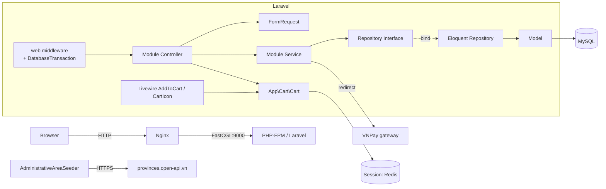
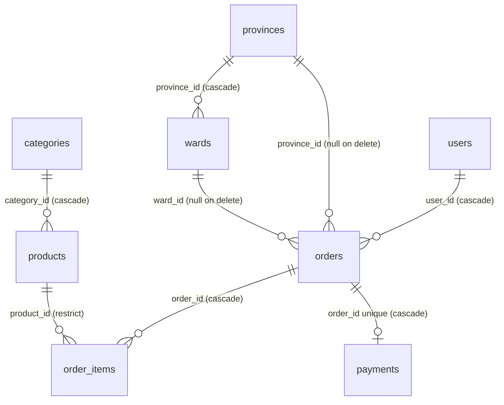
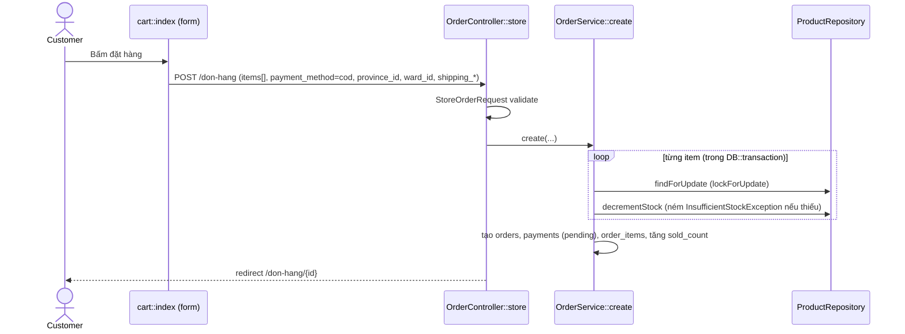
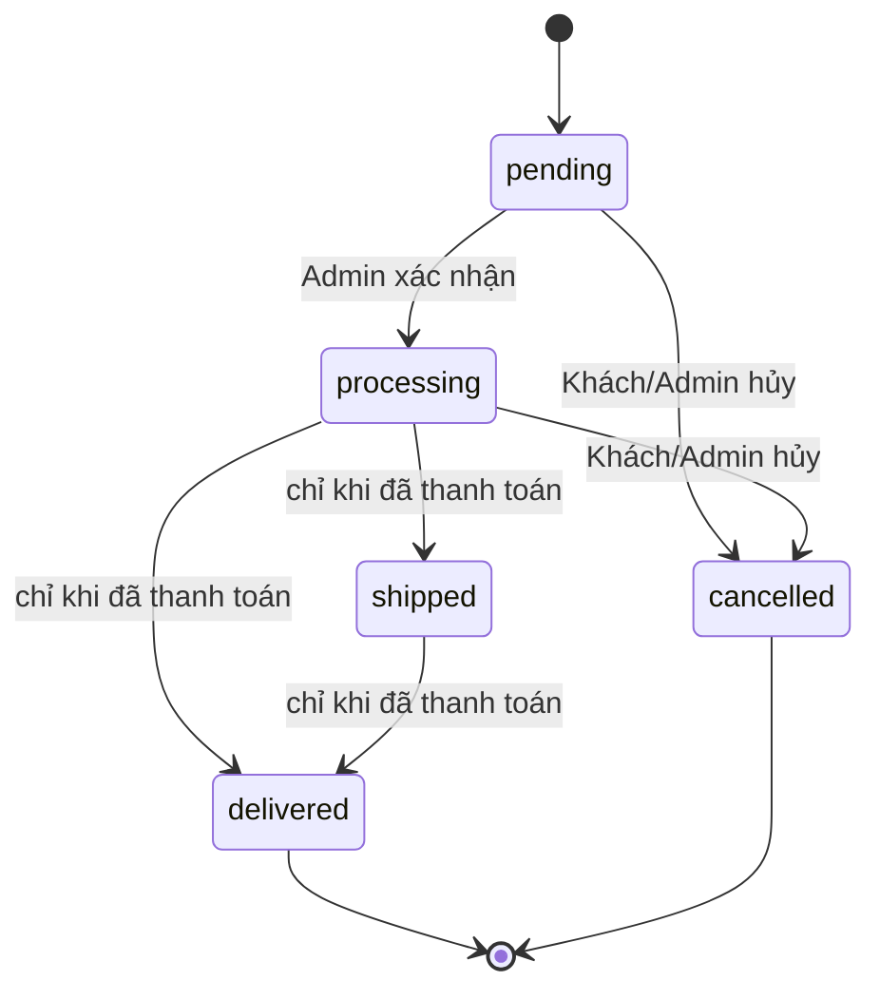

# Onboarding — Nông Sản Thái Bình

Tài liệu dành cho thành viên mới. Mọi nhận định đều dẫn nguồn trong repository; những gì chưa xác minh được ghi rõ. Khi tài liệu này hoặc `README.md` mâu thuẫn với code, **code là căn cứ**.

---

## 1. Tổng quan sản phẩm và nghiệp vụ

Website thương mại điện tử B2C bán nông sản đặc sản Thái Bình (`composer.json` mô tả: "E-commerce platform for Thai Binh agricultural products"). Giao diện, route và thông báo đều bằng tiếng Việt (ví dụ `app/Modules/Products/Routes/web.php`: `/san-pham`).

**Actor** — enum `UserRole` chỉ có `admin` và `customer` (`app/Models/UserRole.php`, cột `role` trong `database/migrations/2024_01_01_000001_create_users_table.php`):

| Actor | Làm được gì (đã xác minh qua route) |
|---|---|
| Khách vãng lai | Xem trang chủ, sản phẩm, blog, trang tĩnh; thêm/sửa giỏ hàng (giỏ không cần đăng nhập) — `app/Modules/{Home,Products,Blog,Cart}/Routes/web.php` |
| Customer (đã đăng nhập) | Đặt hàng, xem/hủy đơn của mình, khởi tạo thanh toán — `app/Modules/Orders/Routes/web.php`, `app/Modules/Payments/Routes/web.php` |
| Admin | Dashboard, CRUD sản phẩm, quản lý đơn (đổi trạng thái, ghi nhận đã thanh toán), xem user, CRUD blog — `app/Modules/Admin/Routes/web.php`, `app/Modules/Blog/Routes/web.php` |

Đăng ký mới luôn tạo `customer` (`app/Modules/Auth/Services/AuthService.php:48`). Không có route tạo admin; admin đến từ seeder (`database/seeders/UserSeeder.php`).

**Thuật ngữ nghiệp vụ** (từ enum, nhãn hiển thị là tiếng Việt):

- **Trạng thái đơn** `OrderStatus` (`app/Models/OrderStatus.php`): `pending` (Chờ xác nhận), `processing` (Đã xác nhận), `shipped` (Đang giao hàng), `delivered` (Đã giao), `cancelled` (Đã hủy).
- **Trạng thái thanh toán** `PaymentStatus` (`app/Models/PaymentStatus.php`): `pending`, `completed`, `failed`, `refunded`.
- **Phương thức thanh toán** `PaymentMethod` (`app/Models/PaymentMethod.php`): `vnpay`, `cod`, `bank_transfer`.
- **Tỉnh/thành – phường/xã** (`provinces`, `wards`): dùng cho địa chỉ giao hàng, nạp từ API công khai khi seed (`database/seeders/AdministrativeAreaSeeder.php:15-18`).

---

## 2. Tech stack

| Thành phần | Công nghệ | Nguồn |
|---|---|---|
| Ngôn ngữ | PHP `^8.2`; image Docker `php:8.2-fpm-alpine` | `composer.json:7`, `docker/php/Dockerfile:1` |
| Framework | Laravel `^11.0` (cấu trúc `bootstrap/app.php` kiểu Laravel 11) | `composer.json:8` |
| UI động | Livewire `^3.0` (2 component) | `composer.json:10`, `app/Livewire/` |
| Template | Blade, view theo từng module | `app/Modules/*/Views/` |
| CSS | Tailwind **qua CDN** `cdn.tailwindcss.com` | `resources/views/layouts/app.blade.php:10` |
| Auth | Session guard của Laravel (`Auth::attempt`) | `app/Modules/Auth/Services/AuthService.php:25` |
| Sanctum | `^4.0` có trong dependency, `User` dùng `HasApiTokens`, nhưng chưa có API route nào | `composer.json:11`, `app/Models/User.php:13`, `routes/api.php` |
| Database | MySQL 8.0 (Docker) | `docker-compose.yml:46` |
| Cache / Session / Queue | Redis 7 (Docker env) | `docker-compose.yml:70`, `.env.docker` (`CACHE_STORE`, `SESSION_DRIVER`, `QUEUE_CONNECTION`) |
| Web server | Nginx 1.25 → PHP-FPM `php:9000` | `docker-compose.yml:30`, `docker/nginx/default.conf:23` |
| Thanh toán | VNPay (HMAC-SHA512) | `app/Modules/Payments/Services/VnpayService.php` |
| Test | PHPUnit `^10.5`, Mockery | `composer.json:17-18`, `phpunit.xml` |
| Code style | Laravel Pint `^1.13` (chưa có file cấu hình riêng) | `composer.json:14` |
| Frontend build | Vite 6 + laravel-vite-plugin, Tailwind 3 trong `devDependencies` — **xem mục 11, hiện không được dùng** | `package.json`, `vite.config.js` |

Phiên bản chính xác đã khóa nằm trong `composer.lock`. Không có `package-lock.json` trong repo.

---

## 3. Kiến trúc ứng dụng

### 3.1 Khởi động và đăng ký module

- Entry HTTP: `public/index.php` → `bootstrap/app.php`.
- `bootstrap/app.php:20-33` đăng ký `RepositoryServiceProvider` và 8 module provider: Home, Blog, Auth, Cart, Products, Orders, Payments, Admin.
- Mỗi module provider trong `boot()` nạp `app/Modules/<Module>/Routes/web.php` dưới middleware `web` và đăng ký view namespace (ví dụ `app/Modules/Home/Providers/HomeServiceProvider.php:12-16` → `view('home::index')`).
- `routes/web.php` gần như rỗng, chỉ định nghĩa `/up`; `routes/api.php` chỉ có group `v1` rỗng.

### 3.2 Các lớp

Luồng gọi điển hình: **Route → Controller → (FormRequest) → Service → Repository Interface → Eloquent Repository → Model**.



| Lớp | Vị trí | Ghi chú |
|---|---|---|
| Middleware | `app/Http/Middleware/` | `EnsureUserIsAdmin` (alias `admin`), `DatabaseTransaction` (prepend vào nhóm `web`) — `bootstrap/app.php:41-46` |
| Controller | `app/Modules/*/Controllers/` | Mỏng; một số controller admin gọi thẳng repository (ví dụ `ProductAdminController`) |
| FormRequest | `app/Modules/*/Requests/` | Validate input |
| Service | `app/Modules/*/Services/` | Business logic, transaction |
| Repository | `app/Repositories/Contracts` + `app/Repositories/Eloquent` | Bind trong `app/Providers/RepositoryServiceProvider.php:114-123` (8 cặp) |
| Model + Enum | `app/Models/` | Enum là PHP backed enum nằm cùng thư mục Models |
| Giỏ hàng | `app/Cart/Cart.php`, `app/Cart/CartItem.php` | Singleton (`app/Providers/RepositoryServiceProvider.php:128`), lưu trong session key `cart` |
| Livewire | `app/Livewire/`, view ở `resources/views/livewire/` | `AddToCart` dispatch `cart-updated`; `CartIcon` lắng nghe qua `#[On('cart-updated')]` (`app/Livewire/CartIcon.php:23`) |
| Helper toàn cục | `app/Helpers/helpers.php` | `format_currency`, `format_weight`, `short_number` (autoload qua `composer.json:27`) |
| Layout chung | `resources/views/layouts/app.blade.php` | View composer chia sẻ `headerCategories`/`mobileCategories` (`app/Providers/RepositoryServiceProvider.php:134-144`) |

### 3.3 Transaction — điều cần biết

`DatabaseTransaction` bọc **mọi request thuộc nhóm `web`** trong `DB::transaction` (`app/Http/Middleware/DatabaseTransaction.php:20`). Các service còn mở transaction riêng (ví dụ `app/Modules/Orders/Services/OrderService.php:61`), nên chúng chạy lồng nhau (savepoint). Hệ quả: exception ở bất kỳ đâu trong request sẽ rollback toàn bộ ghi DB của request đó; side effect ngoài DB (file upload, redirect sang VNPay) không được rollback — code upload ảnh tự dọn file khi lỗi (`app/Modules/Admin/Controllers/ProductAdminController.php:114-150`).

---

## 4. Cấu trúc repository

| Bạn cần làm… | Tìm ở |
|---|---|
| Thêm/sửa trang hoặc tính năng người dùng | `app/Modules/<Module>/{Routes,Controllers,Services,Requests,Views}` |
| Truy vấn DB | `app/Repositories/Eloquent/*Repository.php` (+ interface tương ứng trong `Contracts/`) |
| Thêm repository mới | Tạo interface + implementation, thêm vào `$bindings` của `app/Providers/RepositoryServiceProvider.php` |
| Thêm module mới | Tạo provider trong module, đăng ký ở `bootstrap/app.php` (và hiện cả `bootstrap/providers.php`, xem mục 11) |
| Quy tắc trạng thái đơn | `app/Models/OrderStatus.php` (`canTransitionTo`) |
| Giỏ hàng | `app/Cart/`, `app/Modules/Cart/`, `app/Livewire/` |
| Header/footer/menu | `resources/views/layouts/app.blade.php` |
| Schema | `database/migrations/` |
| Dữ liệu mẫu | `database/seeders/` |
| Docker / Nginx / PHP | `docker-compose.yml`, `docker/` |
| Lệnh tắt | `Makefile` |
| Test | `tests/Unit`, `tests/Feature` |

---

## 5. Mô hình dữ liệu

Nguồn: `database/migrations/` (15 file) và quan hệ trong `app/Models/`.



| Bảng | Cột đáng chú ý | Nguồn |
|---|---|---|
| `users` | `role` enum(admin, customer), `phone`, `address`, `city` | `…000001_create_users_table.php` |
| `categories` | `slug` unique | `…000002_…` |
| `products` | `price` decimal(12,2), `stock`, `status` enum(active, inactive), `slug`, `view_count`, `sold_count`, `thumbnail`, `images` (JSON) | `…000003`, `…000007`, `2026_10_07_000001_…` |
| `orders` | `total_amount`, `status`, `payment_status`, `notes`, `shipping_address`, `shipping_phone`, `province_id`, `ward_id` | `…000004`, `2026_10_05_000003`, `2026_10_05_000004` |
| `order_items` | `quantity`, `price` (giá chốt tại thời điểm đặt) | `…000005_…`, `app/Modules/Orders/Services/OrderService.php:73-77` |
| `payments` | 1-1 với order, `method`, `status`, `transaction_id` unique, `paid_at` | `…000006_…` |
| `provinces`, `wards` | `code` unique, `codename`, `division_type` | `2026_10_05_000001/2` |
| `blogs` | `title`, `slug`, `excerpt`, `content`, `thumbnail`, `is_active` | `…000010_…` |
| `menu_items`, `pages` | Migration **tự insert dữ liệu mặc định** (4 menu, 4 trang) | `…000008_…`, `…000009_…` |

Lưu ý:
- `orders.status`/`payment_status` vừa là enum MySQL vừa được cast sang PHP enum trong `app/Models/Order.php:27`. Thêm trạng thái mới phải sửa cả hai (cần migration).
- `orders.payment_status` là bản sao của `payments.status`; code cập nhật cả hai (`app/Modules/Orders/Services/OrderService.php:143-147`, `app/Modules/Payments/Controllers/PaymentController.php:72-73`). `Order::isPaid()` đọc `orders.payment_status` (`app/Models/Order.php:58-61`).
- Slug sản phẩm sinh tự động qua trait `app/Traits/HasSlug.php`; blog sinh slug trong `BlogService::uniqueSlugForTitle`.
- Không có migration cho bảng `sessions`, `cache`, `jobs`, `personal_access_tokens`.

---

## 6. Luồng nghiệp vụ tiêu biểu

### 6.1 Duyệt sản phẩm

1. `GET /san-pham` → `ProductController::index` lấy filter `category`, `search`, `sort` → `ProductService::list` → `ProductRepository::paginateActive` (16 item/trang) — `app/Modules/Products/Controllers/ProductController.php:15-22`.
2. `GET /san-pham/{product:slug}` → tăng `view_count` (`ProductService::trackView`) và lấy 4 sản phẩm liên quan.
3. Trang chủ `GET /` hiển thị bán chạy (`sold_count`), xem nhiều (`view_count`), đã mua gần đây (chỉ khi đăng nhập) — `app/Modules/Home/Services/HomeService.php`.

### 6.2 Giỏ hàng

- Thêm: Livewire `AddToCart::add` (`app/Livewire/AddToCart.php:29-62`) hoặc `POST /gio-hang/them/{product}` (`CartController::add`). Số lượng bị chặn bởi `stock` (`app/Cart/Cart.php:73`).
- Cập nhật/xóa: `PATCH /gio-hang/cap-nhat/{productId}`, `DELETE /gio-hang/xoa/{productId}`, `DELETE /gio-hang`.
- Chọn phường/xã: JS trong `app/Modules/Cart/Views/index.blade.php:185-201` gọi `GET /gio-hang/tinh-thanh/{province}/phuong-xa` → JSON qua `WardResource`.

### 6.3 Đặt hàng



- Form gửi danh sách item ẩn từ giỏ và **cố định `payment_method=cod`** (`app/Modules/Cart/Views/index.blade.php:109-115`).
- Validate: tối đa 100/sản phẩm, `ward_id` phải thuộc `province_id`, regex số điện thoại (`app/Modules/Orders/Requests/StoreOrderRequest.php`).
- Giá tính lại từ DB, không tin giá trong session (`app/Modules/Orders/Services/OrderService.php:68`).
- Chưa tìm thấy code xóa giỏ hàng sau khi đặt thành công (xem mục 11).

### 6.4 Vòng đời trạng thái đơn

Quy tắc trong `OrderStatus::canTransitionTo` (`app/Models/OrderStatus.php:40-49`), áp dụng qua `OrderService::transitionStatus` (`app/Modules/Orders/Services/OrderService.php:153-179`):



- Hủy đơn hoàn `stock` cho từng item trong transaction có `lockForUpdate` trên đơn.
- Khách chỉ hủy được đơn của mình (`OrderService::cancel`, `PATCH /don-hang/{order}/cancel`).
- Admin ghi nhận đã thanh toán (`PATCH /admin/orders/{order}/payment` → `OrderService::markPaidByAdmin`) chỉ khi đơn đang `processing` và chưa thanh toán; nếu chưa có bản ghi payment sẽ tạo với method COD (`app/Modules/Orders/Services/OrderService.php:128-151`).
- Hoàn tiền (`refunded`) có trong enum nhưng chưa thấy luồng nào gán giá trị này.

### 6.5 Thanh toán VNPay

Code: `app/Modules/Payments/`. Service được khởi tạo từ `config/vnpay.php` (`app/Modules/Payments/Providers/PaymentsServiceProvider.php:13-18`).

1. `GET /thanh-toan/don-hang/{order}` (`PaymentController::initiate`): kiểm tra chủ đơn, nếu method là COD thì render `payments::cod-confirm`, ngược lại redirect sang VNPay với URL ký HMAC-SHA512 (`VnpayService::buildPaymentUrl`, `vnp_TxnRef = {orderId}_{timestamp}`).
2. `GET /thanh-toan/callback` (không cần đăng nhập): `verifyCallback` → `isSuccessful` (`vnp_ResponseCode === '00'`) → `markCompleted`/`markFailed` → redirect `payments.result`.
3. `GET /thanh-toan/ket-qua/{order}` render `payments::result`.

**Trạng thái thực tế:** module Payments **không có thư mục `Views/`**, nên các view `payments::cod-confirm` và `payments::result` không tồn tại; không view nào link tới route `payments.*`. Luồng VNPay đã có service và unit test (`tests/Unit/VnpayServiceTest.php`) nhưng chưa nối vào UI (xem mục 11).

### 6.6 Quản trị

- Dashboard: `DashboardService::stats` — doanh thu (đơn `payment_status=completed`), đơn hôm nay, đơn chờ, tồn kho thấp, số khách, doanh thu 6 tháng (`app/Modules/Admin/Services/DashboardService.php`). `revenueByMonth` dùng `YEAR()`/`MONTH()` của MySQL (`app/Repositories/Eloquent/OrderRepository.php:73-85`).
- Sản phẩm: resource route `admin/products`; upload tối đa 5 ảnh jpg/jpeg/png/webp, ≤ 5 MB mỗi ảnh vào disk `public` thư mục `products/`, ảnh đầu tiên làm `thumbnail` (`app/Modules/Admin/Requests/ProductRequest.php:22-23`, `app/Modules/Admin/Controllers/ProductAdminController.php:41-60`).
- Blog: `admin/blogs` (trừ `show`), thumbnail lưu `blogs/` trên disk `public` (`app/Modules/Blog/Services/BlogThumbnailStorage.php`). Trang công khai `/blog`, `/blog/{slug}`.
- Đơn hàng, người dùng: chỉ xem danh sách/chi tiết, đổi trạng thái đơn và ghi nhận thanh toán.

---

## 7. Hạ tầng và cách chạy

### 7.1 Docker Compose (`docker-compose.yml`)

| Service | Image | Cổng host → container | Phụ thuộc |
|---|---|---|---|
| `php` | build `docker/php/Dockerfile` | — (FPM 9000 trong network) | `mysql`, `redis` healthy |
| `nginx` | `nginx:1.25-alpine` | 8000 → 80 | `php` healthy |
| `mysql` | `mysql:8.0` | 3307 → 3306 | — |
| `redis` | `redis:7-alpine` | 6380 → 6379 | — |
| `phpmyadmin` | `phpmyadmin:5.2` | 8080 → 80 | `mysql` healthy |

- Source được bind mount vào `/var/www/html`; `vendor/` nằm trong named volume `vendor_data` (`docker-compose.yml:12-13`) — `vendor` trên host sẽ trống.
- `php` đọc env từ `.env.docker` (`docker-compose.yml:10`). Credentials MySQL cho môi trường local được khai báo trực tiếp trong compose; chỉ dùng cho dev.

**Entrypoint** (`docker/php/entrypoint.sh`) mỗi lần container khởi động:
1. Tạo thư mục `storage/…`, `chmod 777`.
2. Copy `.env.docker` → `.env` nếu chưa có; sinh `APP_KEY` nếu trống.
3. `composer install` nếu chưa có `vendor/autoload.php`.
4. Chờ MySQL, **chạy `migrate --force`**.
5. **Chạy `db:seed`** nếu bảng `users` rỗng — `AdministrativeAreaSeeder` cần Internet tới `provinces.open-api.vn`.
6. `storage:link`, xóa config/route/view cache.

### 7.2 Lệnh thường dùng (`Makefile`)

Tất cả target đều gọi `sudo docker compose …`.

```bash
make up            # build + start
make down
make shell         # bash trong container php
make logs / make logs-php
make migrate / make seed
make fresh         # migrate:fresh --seed — XÓA toàn bộ dữ liệu
make cache-clear   # optimize:clear
make artisan CMD="route:list"
```

Truy cập: app `http://localhost:8000`, admin `/admin`, phpMyAdmin `http://localhost:8080`. Tài khoản mẫu (1 admin, 5 customer) xem trong `database/seeders/UserSeeder.php`.

### 7.3 Chạy không dùng Docker

`README.md` có hướng dẫn (`composer install`, `cp .env.example .env`, `php artisan key:generate`, `migrate`, `db:seed`, `storage:link`, `php artisan serve`). Khi làm theo, lưu ý các điểm lệch của `.env.example` ở mục 8 và 11.

---

## 8. Cấu hình và tích hợp

Biến môi trường (tên lấy từ `.env.example`, `.env.docker`, `config/*.php`; **không ghi giá trị bí mật**):

| Nhóm | Biến | Ghi chú |
|---|---|---|
| App | `APP_NAME`, `APP_ENV`, `APP_KEY`, `APP_DEBUG`, `APP_URL` | `AppServiceProvider` ép root URL = `APP_URL` và ép `https` khi `APP_ENV=production` (`app/Providers/AppServiceProvider.php:70-80`) |
| Log | `LOG_CHANNEL`, `LOG_LEVEL` | |
| DB | `DB_CONNECTION`, `DB_HOST`, `DB_PORT`, `DB_DATABASE`, `DB_USERNAME`, `DB_PASSWORD` | `.env.example` đặt `DB_HOST=mysql` (tên service Docker) |
| Cache/Session/Queue | `CACHE_STORE`, `SESSION_DRIVER`, `QUEUE_CONNECTION` | Docker: Redis. `.env.example` dùng `CACHE_DRIVER` (Laravel 11 đọc `CACHE_STORE`, `config/cache.php:18`) và `SESSION_DRIVER=cookie` |
| Redis | `REDIS_HOST`, `REDIS_PORT`, `REDIS_PASSWORD` | Chỉ có trong `.env.docker` |
| Mail | `MAIL_MAILER` | `log` ở cả hai file mẫu; code chưa gửi mail |
| VNPay | `VNPAY_MERCHANT_ID`, `VNPAY_SECRET_KEY`, `VNPAY_URL`, `VNPAY_RETURN_URL` | Đọc qua `config/vnpay.php`. `VNPAY_MERCHANT_ID_HASH` có trong file env mẫu nhưng không được code đọc |

Tích hợp ngoài đã xác minh:
- **VNPay**: redirect + callback, chữ ký HMAC-SHA512 (`app/Modules/Payments/Services/VnpayService.php`). Chỉ có return URL, không có IPN endpoint.
- **provinces.open-api.vn**: chỉ dùng lúc seed (`database/seeders/AdministrativeAreaSeeder.php:15`).
- **Tailwind CDN**: tải ở runtime trên trình duyệt (`resources/views/layouts/app.blade.php:10`).

An toàn cấu hình:
- `.env` bị gitignore (`.gitignore:3`), nhưng `.env.docker` **được commit** và được copy thành `.env` khi container khởi động. Không đặt secret thật (key VNPay production, mật khẩu thật) vào `.env.docker`; dùng `.env` cục bộ hoặc cơ chế secret của môi trường triển khai.
- Nginx chặn file ẩn như `.env`, `.git` (`docker/nginx/default.conf:53-55`).

---

## 9. Kiểm thử và chất lượng

- Cấu hình: `phpunit.xml`, 2 suite `Unit` và `Feature`; env test: cache/session `array`, queue `sync`.
- Hiện có 8 file test:
  - Unit: `CartItemTest`, `CartTest`, `OrderServiceTest` (Mockery, chỉ kiểm tra validate đầu vào), `OrderStatusTest` (quy tắc chuyển trạng thái), `VnpayServiceTest` (ký/verify chữ ký).
  - Feature: `HealthCheckTest` (`GET /up`), `OrdersShowViewTest`, `ProvinceWardEndpointTest` (tự chuyển sang SQLite in-memory và tự tạo bảng trong `setUp`).
- Không có factory (`database/factories/` không tồn tại dù được khai báo autoload), không có trait `RefreshDatabase`.
- Chạy test (trong container):
  ```bash
  make shell
  php artisan test          # hoặc vendor/bin/phpunit
  ```
- Lint: `vendor/bin/pint` (có trong dev dependency).
- **Chưa có CI** (`.github/` chỉ chứa prompt).
- **Chưa chạy test hay build khi viết tài liệu này** — máy phân tích không có `vendor/`. Chưa xác minh test nào có cần MySQL/Redis thật không (ví dụ `/up` đi qua middleware `DatabaseTransaction`).

---

## 10. Lộ trình đọc code cho người mới

1. `bootstrap/app.php` — provider, middleware, cách module được nạp.
2. `app/Providers/RepositoryServiceProvider.php` — binding repository, Cart singleton, view composer.
3. Một module đơn giản trọn vẹn: `app/Modules/Products/` (Routes → Controller → Service) rồi `app/Repositories/Eloquent/ProductRepository.php`.
4. Giỏ hàng: `app/Cart/Cart.php` → `app/Livewire/AddToCart.php` → `app/Modules/Cart/Views/index.blade.php` (form checkout).
5. Lõi nghiệp vụ: `app/Modules/Orders/Services/OrderService.php` + `app/Models/OrderStatus.php`.
6. Quản trị đơn: `app/Modules/Admin/Controllers/OrderAdminController.php`.
7. Thanh toán: `app/Modules/Payments/Services/VnpayService.php` + `tests/Unit/VnpayServiceTest.php`.
8. Hạ tầng: `docker-compose.yml` → `docker/php/entrypoint.sh` → `Makefile`.

---

## 11. Điểm cần xác nhận

Mâu thuẫn hoặc khoảng trống tìm thấy khi đối chiếu code (chưa sửa gì, chỉ ghi nhận):

1. **Payments chưa nối với UI**: thiếu `app/Modules/Payments/Views/` (view `payments::cod-confirm`, `payments::result` được gọi ở `app/Modules/Payments/Controllers/PaymentController.php:45,96`); không view nào link tới `payments.*`; checkout cố định `payment_method=cod`. README mô tả luồng VNPay như đã hoạt động.
2. **Return URL VNPay lệch route**: mặc định `VNPAY_RETURN_URL` là `/payment/callback` (`config/vnpay.php:7`, file env mẫu) trong khi route là `/thanh-toan/callback` (`app/Modules/Payments/Routes/web.php:8`).
3. **Page và MenuItem admin chưa có route**: `PageAdminController`, `MenuItemAdminController`, service, request, view (`app/Modules/Admin/Views/pages|menu-items`) và bảng `pages`/`menu_items` đều có, nhưng `app/Modules/Admin/Routes/web.php` không đăng ký `admin.pages.*`/`admin.menu-items.*`. Menu header đang hard-code (`resources/views/layouts/app.blade.php:54-83`); `/gioi-thieu`, `/lien-he`… render view tĩnh thay vì bảng `pages`; `app/Modules/Home/Views/page.blade.php` không có route dùng tới.
4. **Giỏ hàng không bị xóa sau khi đặt hàng**: không có lời gọi `Cart::clear()` trong luồng tạo đơn (chỉ ở `CartController::clear`). Cần xác nhận đây là cố ý hay thiếu.
5. **Vite không dùng được**: `vite.config.js` trỏ tới `resources/css/app.css` và `resources/js/app.js` nhưng hai file không tồn tại; layout dùng Tailwind CDN. `npm run build` gần như chắc chắn lỗi (chưa chạy thử).
6. **`.env.example` cho chạy thủ công**: dùng `CACHE_DRIVER` thay vì `CACHE_STORE`, không có `QUEUE_CONNECTION`/`REDIS_*`; giá trị mặc định trong config là driver `database` cho cache/queue (`config/cache.php:18`, `config/queue.php:16`) nhưng không có migration bảng `cache`/`jobs`. `DB_HOST` là `mysql` trong khi README hướng dẫn `127.0.0.1`.
7. **Provider khai báo hai nơi**: các module provider có trong cả `bootstrap/app.php` và `bootstrap/providers.php`; `AppServiceProvider` chỉ có ở `bootstrap/providers.php`. README chỉ nói đăng ký ở `bootstrap/app.php`. Nên thống nhất một nơi.
8. **`/up` định nghĩa hai lần**: `health: '/up'` trong `bootstrap/app.php:38` và route riêng ở `routes/web.php:15`.
9. **Sanctum chưa dùng**: không có API route, không có migration `personal_access_tokens`.
10. **README đã cũ**: ghi "7 migration files" (thực tế 15), thiếu module Blog, bảng provinces/wards/pages/menu_items/blogs, các route mới (blog, phường/xã, `admin/orders/{order}`, `admin/orders/{order}/payment`), liệt kê 3 customer mẫu trong khi seeder có 5.
11. **Log debug trong Livewire**: `AddToCart` ghi `Log::info` ở mount/increment/decrement (`app/Livewire/AddToCart.php:23,71,79`) — có thể gây nhiều log.
12. **Chưa xác định từ repository**: môi trường production, quy trình deploy, CI/CD, backup, giám sát, quy mô tải, cấu hình VNPay production, có chạy queue worker hay không.

---

*Phân tích ngày 2026-11-11 trên nhánh `master` (commit `546fa24`). Phạm vi: README, manifest (`composer.json`, `package.json`), `bootstrap/`, `routes/`, `config/` liên quan, toàn bộ route/provider module, các controller/service chính (Cart, Orders, Payments, Admin, Auth, Products, Home, Blog), model/enum, migration, seeder, test, Docker/Nginx/Makefile và tên biến trong file env mẫu. Không chạy test, build, migrate hay seed.*
